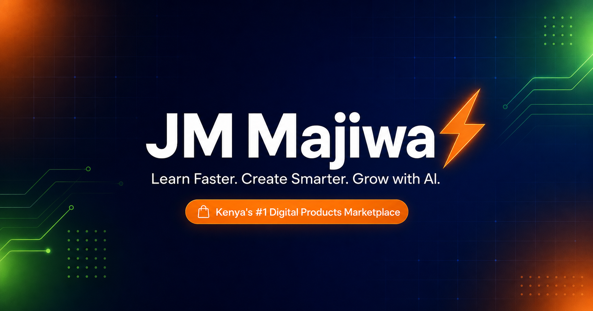

<p align="center">
  
</p>

<h1 align="center">⚡ JM Majiwa — Digital Products Marketplace</h1>

<p align="center">
  <strong>Learn Faster. Create Smarter. Grow with AI.</strong><br/>
  Kenya's #1 digital products marketplace — AI prompt packs, Canva templates,
  eBooks, study materials and business tools. Pay with M-Pesa, download instantly.
</p>

<p align="center">
  <a href="https://jmmajiwa.com"></a>
  
  
  
  
  
</p>

<p align="center">
  <a href="https://vercel.com/new/clone?repository-url=https%3A%2F%2Fgithub.com%2Fstreetpandacyber%2Fstreet-panda-cyber&env=NEXT_PUBLIC_SUPABASE_URL,NEXT_PUBLIC_SUPABASE_ANON_KEY,SUPABASE_SERVICE_ROLE_KEY,MPESA_CONSUMER_KEY,MPESA_CONSUMER_SECRET,MPESA_PASSKEY,MPESA_SHORTCODE,MPESA_CALLBACK_URL,RESEND_API_KEY&project-name=jm-majiwa">
    
  </a>
</p>

---

## ✨ Features

- 🛍️ **Full marketplace** — categories, filters, sorting, search, badges & load-more pagination
- 📲 **M-Pesa STK Push payments** — Safaricom Daraja integration with callback handling & status polling
- ⚡ **Instant automated delivery** — signed, expiring, download-limited links the second payment confirms
- 📧 **Transactional emails** — order confirmations, download notifications and newsletter welcome gifts (Resend + React Email)
- 🎁 **Bundles & coupons** — value bundles with savings math, `WELCOME20` / `NEWUSER` coupon validation
- 👤 **Accounts & dashboards** — Supabase Auth, order history, downloads, wishlist and editable profiles
- 🛠️ **Admin panel** — revenue chart (Recharts), orders table and a full product creation form
- 📖 **Learning Hub & blog** — SEO-rich articles with related posts and reading stats
- 🔐 **Security-first** — RLS policies, service-role APIs, security headers, middleware route protection
- 📱 **Mobile-first design** — sticky bottom nav, slide-in cart, Framer Motion animations everywhere
- 🔍 **SEO ready** — metadata, OpenGraph image, sitemap and robots generated dynamically

## 🧰 Tech Stack

| Layer      | Technology                                             |
| ---------- | ------------------------------------------------------ |
| Framework  | Next.js 14 (App Router, TypeScript)                     |
| Styling    | Tailwind CSS 3 + tailwindcss-animate + custom design system |
| Animation  | Framer Motion                                           |
| Database   | Supabase (Postgres + Auth + Storage + RLS)              |
| Payments   | Safaricom M-Pesa Daraja API (STK Push)                  |
| Email      | Resend + React Email                                    |
| State      | Zustand (persisted cart & wishlist)                     |
| Forms      | React Hook Form + Zod                                   |
| Charts     | Recharts                                                |
| UI Extras  | Radix UI primitives, lucide-react, sonner, next-themes  |
| CI         | GitHub Actions (lint → type-check → build)              |

## 🚀 Quick Start

```bash
# 1. Clone the repository
git clone https://github.com/streetpandacyber/street-panda-cyber.git jm-majiwa
cd jm-majiwa

# 2. Install dependencies
npm install

# 3. Configure environment
cp .env.example .env.local
# …then fill in your Supabase, M-Pesa Daraja and Resend credentials

# 4. Set up the database (requires Supabase CLI linked to your project)
npm run db:push        # applies supabase/migrations/001_schema.sql
# run supabase/seed.sql from the Supabase SQL editor for demo content

# 5. Run the dev server
npm run dev
```

The site works **out of the box with demo data** — add real credentials to
switch every page to live Supabase data automatically.

### Scripts

| Script                | Description                          |
| --------------------- | ------------------------------------ |
| `npm run dev`         | Start the development server          |
| `npm run build`       | Production build                      |
| `npm run start`       | Serve the production build            |
| `npm run lint`        | ESLint                                |
| `npm run type-check`  | TypeScript type checking              |
| `npm run format`      | Prettier (write)                      |
| `npm run format:check`| Prettier (check)                      |
| `npm run db:push`     | Push the SQL migration to Supabase    |
| `npm run db:reset`    | Reset the Supabase database           |
| `npm run email:dev`   | React Email preview server            |

## 🔑 Environment Variables

| Variable | Description |
| -------- | ----------- |
| `NEXT_PUBLIC_SUPABASE_URL` | Your Supabase project URL |
| `NEXT_PUBLIC_SUPABASE_ANON_KEY` | Supabase anon/public key |
| `SUPABASE_SERVICE_ROLE_KEY` | Service role key (server only — never expose) |
| `MPESA_CONSUMER_KEY` / `MPESA_CONSUMER_SECRET` | Daraja app credentials |
| `MPESA_PASSKEY` | STK Push passkey for your shortcode |
| `MPESA_SHORTCODE` | Business shortcode (default `174379` in sandbox) |
| `MPESA_CALLBACK_URL` | Public HTTPS URL for `/api/mpesa/callback` |
| `MPESA_ENVIRONMENT` | `sandbox` or `production` |
| `RESEND_API_KEY` | Resend API key for transactional email |
| `FROM_EMAIL` / `FROM_NAME` | Sender identity |
| `NEXT_PUBLIC_APP_URL` | Canonical app URL (used in sitemap/OG/emails) |
| `NEXT_PUBLIC_APP_NAME` / `NEXT_PUBLIC_APP_DESCRIPTION` | Branding used in metadata |
| `ADMIN_EMAIL` | Primary admin contact |

## 📁 Folder Structure

```
├── emails/                     # React Email templates
├── public/og/                  # OpenGraph image
├── supabase/
│   ├── migrations/001_schema.sql   # Full schema, RLS, triggers
│   └── seed.sql                    # Categories, products, bundles, coupons, posts
└── src/
    ├── app/
    │   ├── (main)/             # Storefront: home, marketplace, products,
    │   │                       # bundles, learning hub, blog, about, policies
    │   ├── (auth)/             # login / register / forgot-password
    │   ├── (dashboard)/        # user dashboard (orders, downloads, wishlist…)
    │   ├── (admin)/            # admin panel
    │   ├── api/                # orders, M-Pesa initiate/callback/status,
    │   │                       # downloads, newsletter, coupons
    │   ├── layout.tsx          # root layout + SEO metadata
    │   ├── sitemap.ts          # dynamic sitemap
    │   └── robots.ts           # robots rules
    ├── components/             # layout, home, marketplace, cart, product…
    ├── lib/
    │   ├── supabase/           # browser / server / admin / middleware clients
    │   ├── mpesa/daraja.ts     # STK Push implementation
    │   ├── data/               # service layer + demo fallback data
    │   ├── email.ts            # Resend helper
    │   └── utils.ts            # cn, formatters, validators
    ├── store/                  # Zustand cart & wishlist (persisted)
    ├── types/                  # shared TypeScript models
    └── middleware.ts           # session refresh + route protection
```

## ☁️ Deployment

### Vercel (recommended)

1. Push this repository to GitHub and import it in Vercel.
2. Add every variable from `.env.example` in **Project → Settings → Environment Variables**.
3. Set `MPESA_CALLBACK_URL` to `https://<your-domain>/api/mpesa/callback`.
4. Deploy — the CI pipeline verifies lint, types and build first.

### Supabase setup checklist

1. Create a project and run `supabase/migrations/001_schema.sql` (or `supabase db push`).
2. Run `supabase/seed.sql` for starter content.
3. Create a **private** storage bucket named `products` (the migration creates it) and upload product files into it.
4. Grant your first admin: `update profiles set is_admin = true where email = 'you@example.com';`

### M-Pesa (Daraja) checklist

1. Create an app at [developer.safaricom.co.ke](https://developer.safaricom.co.ke) and copy the consumer key/secret.
2. Use the sandbox Lip Na M-Pesa test credentials (shortcode `174379`) while testing.
3. Expose your callback URL over HTTPS (Vercel domain works perfectly).
4. Switch `MPESA_ENVIRONMENT=production` with production credentials when ready.

## 💬 Support

- 📧 Email: streetpandacyber@gmail.com
- 💬 WhatsApp: +254 745 198 099
- 📞 Call: 0745 198 099
- 👍 Facebook: @JM Majiwa

## 🤝 Contributing

We love contributions! To get started:

1. Fork the repo and create a feature branch (`feat/your-idea`).
2. Follow the design system: navy/orange/neon palette, `rounded-3xl` cards,
   Framer Motion scroll animations, mobile-first grids.
3. Use **conventional commits** (`feat:`, `fix:`, `chore:`, `docs:`).
4. Ensure `npm run lint`, `npm run type-check` and `npm run build` pass.
5. Open a pull request using the PR template.

Please read the issue templates when reporting bugs or proposing features.

## 📄 License

MIT © JM Majiwa. Made with ❤️ in Kenya.
